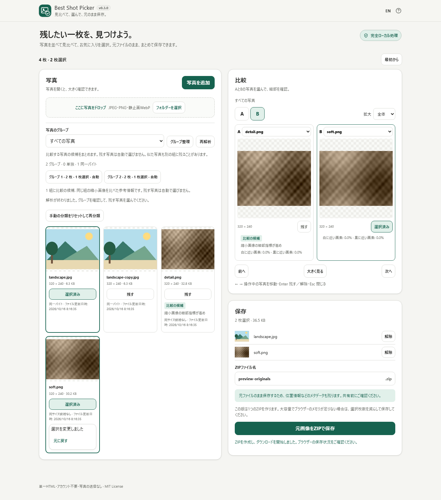

# Best Shot Picker / ベストショット選び

写真を見比べてお気に入りを選び、元ファイルのままZIPでまとめて保存するツールです。

[English](README.md) · [アプリを開く](https://ttomohisa.github.io/htmlapps-best-shot-picker/)



## できること

- JPEG・PNG・静止画WebPを複数読込。作業途中の追加にも対応
- 同一バイトの重複と保守的な通常の類似グループ。分割・結合・移動と取消
- 任意で端末内モデルを使って似た写真の候補を探し、確認した組み合わせだけを適用
- 比較中の2枚で顔を探し、それぞれ顔を選んで拡大。全体表示にも戻せます
- JPEGのEXIF撮影・デジタル化日時とファイル更新日時を区別
- 同じ組の技術的な比較候補と計測理由。不確か・僅差ならおすすめなし
- サムネイル一覧、大きなプレビュー、2枚比較
- スマートフォンはA／B切替、100%・200%・400%表示のスクロールで細部を確認
- 任意の写真を「残す」に選択。直前の選択変更は元に戻せる
- 元のバイト列をZIP保存。出力名編集と同名ファイルの衝突回避
- 任意で独立した小分けZIPを1つずつ作成し、ダウンロードと保存確認をしてから次へ進む
- 読込失敗の分離、中止、未完了写真の再試行
- 日英切替、キーボード操作、狭い画面のページタブ

## 使い方

1. 「写真を追加」、ドラッグ＆ドロップ、対応環境ではフォルダー選択で読み込みます。 既存の「残す」の選択や手動グループを保ったまま写真を追加できます。
2. 「写真のグループ」または「すべての写真」で確認します。「グループ整理」で分割・移動・結合・確認済みへの切替ができます。写真を開いて大きく見るか、「比較」でAとBを選びます。比較の参考候補が出ても自動では選択しません。気に入った写真を「残す」にします。
   比較画面の「次の未確認グループへ」は移動だけを行います。「確認済みにして次へ」は「残す」が0枚でも今の組を確認済みにして進み、「元に戻す」で元の組へ戻せます。最後は同じ組を表示したまま全組の確認完了を案内します。読み込み・解析中はこの操作を一時停止します。
3. 必要に応じて「似た写真の候補を探す」を押します。通常の解析が完了した自動・未確認のグループが2組以上あり、1回の対象写真が合計36枚以内のときに検索できます。大量の写真がある場合は、比較したいグループを36枚以内になるよう選びます。候補のサムネイルを開いて見比べ、よい組み合わせだけ「この組み合わせを適用」で反映します。「元に戻す」で直前のグループ編集を取り消せます。手動・確認済みのグループは対象外です。
4. 「比較」で任意の「顔を探す」を押すと、それぞれの写真で顔を選んで拡大できます。「全体表示」で戻ります。候補の誤りや見逃しがある場合は通常の拡大を使ってください。
5. 「保存」で選択内容とZIP名を確認し、通常は「元画像をZIPで保存」で1つのZIPを作ります。小分けにする場合は任意の小分けZIPモードを選び、32・64・128・256・512 MiBから容量を指定します。実機で安全性を確認した既定容量はないため、初めは未選択です。
6. 小分けモードでは、開始前にZIPの容量と個数を確認します。開始時の「残す」、元ファイル、格納名、出力名を固定します。その後の選択変更・元に戻す・グループ編集・写真追加は画面の写真集合と次の出力に反映し、開始済みの計画は変えません。
7. 現在の1つだけを作成してから、自分でダウンロードを押します。ブラウザーの保存状況を確認して「保存を確認して次のZIPへ」（最後は「保存を確認して終了」）を押します。次のZIPも別の操作で作成します。自動ダウンロードや自動進行はしません。各`.zip`は単独で展開でき、1つのZIPを分断したファイルではありません。

作成を中止・失敗した場合は、現在のZIPだけを再試行できます。同じZIPをもう一度ダウンロードするときは、重複保存の注意を表示します。作成済み・ダウンロード要求済みのZIPを閉じる／破棄するときは確認します。保存用URLを解放すると、未完了のダウンロードに影響する場合があるためです。「最初から」は従来の確認後に計画とセッションを消去します。再読み込みやページを閉じる操作でも計画が消えるため、先に保存を終えてください。

矢印キーで操作中の比較写真を移動できます。ページや画像にフォーカスがあるときはEnterで「残す」を切り替え、ボタンにフォーカスがあるときは通常のボタン操作になります。Escでダイアログを閉じます。入力欄や選択欄の操作中は写真移動を行いません。

## プライバシー

写真はブラウザー内で処理します。任意の類似候補検索と顔検出ではHTMLに同梱したモデルを使い、利用者が操作したときだけ実行します。画像のアップロード、実行時API、外部フォント、アクセス解析、外部からのモデル取得はありません。公開ページは最初のHTML取得に通信します。CSPの `connect-src 'none'` で実行時接続を制限しています。

ZIPには元のバイト列を保存するため、EXIF、GPS位置情報、色プロファイルなども残ります。共有前にご確認ください。端末の原本を上書き・移動・削除しません。

写真と選択は一時的です。再読み込み、ページを閉じる、「最初から」で消えます。言語設定だけを保存する場合があります。

## ブラウザーと端末

現行Chrome・EdgeのPC／スマートフォン向けに設計しています。日英とも320px以上の幅を対象とし、フォルダー選択はブラウザーが対応している場合だけ表示します。

任意の「似た写真の候補を探す」と「顔を探す」は、どちらもWeb Workersと `DecompressionStream` が必要です。どちらかのAPIがない場合は、任意機能を使えない理由を表示します。通常版HTMLでは、手動比較・「残す」の選択・元画像ZIP保存を続けられます。APIが存在しても、すべての端末でモデルの起動・処理完了を保証するものではありません。

確認した環境と実施済みの項目は[検証結果](docs/VALIDATION.md)をご覧ください。Android／iPhone実機の100・500枚、PCの1,000枚、ピークメモリ、実写真での処理性能は未検証です。

## 任意の保存対象一覧

「保存」で「保存対象の一覧を保存」を開き、JSONまたはCSVを選べます。一覧は別ファイルで、ZIPには追加しません。「残す」写真だけの元名・ZIP内名・保存先ZIP・番号・順序・バイト数を記録します。名前には個人情報が含まれる場合があります。EXIF／GPS・フォルダー情報・日時・モデル結果は加えません。

「1つのZIP」では一覧を押した時点の現在の選択を使います。小分け保存中は開始時の計画に固定し、あとから「残す」を変えても変わりません。保存予定の一覧であり、保存完了の証明ではありません。JSONは名前を正確に保持し、表計算向けのCSVは「file: 」と制御文字の可視表記を使います。選択内容を復元する機能ではありません。[出力形式とCSVの制限](docs/SELECTION_LIST.md)をご確認ください。

## 制限

v0.7.1の開発版です。小分けZIPは計画v0.8の保存拡張の最初の範囲に限り、v0.8全体の完了ではありません。通常のグループ分けは非ML方式で、任意の端末内モデルによる候補検索は試験的な機能です。どちらも似た写真を見逃したり、関係のない写真をまとめたりすることがあります。候補は適用前に確認してください。残す写真を自動で選ばず、一般の写真での分類精度を保証するものでもありません。

36枚の上限は1回の任意検索に適用され、セッション全体の枚数は制限しません。比較したいグループを選び、選ばなかったグループはそのまま残ります。1組で36枚を超えるグループは検索対象に選べません。先頭36枚だけを黙って選んだり、既存のグループを分割したりしません。写真の追加・グループ編集・再解析で候補は消えます。1つ適用するとほかの候補も消えるため、必要なら再検索してください。中止・失敗時も既存のグループ、「残す」の選択、元画像は変わりません。端末によって時間がかかることがありますが、通常の比較・保存は利用できます。

比較のヒントは縮小画像の指標で、写真の好みや被写体の価値は評価しません。人の好みとの一致率は未測定です。ノイズ、意図したボケ、線画、照明で指標が誤解を招くことがあり、暗い写真という理由だけで低評価にはしません。顔検出は比較中の写真を見るための任意の補助で、各写真に最大6候補を表示します。小さい顔・横顔・隠れた顔などは見つからないことがあり、候補が誤っている場合もあります。端末によって時間がかかります。目の状態、顔による順位付け、同一人物の対応付けは行いません。HEIC・RAW・TIFF・アニメーション画像・動画には非対応です。

厳密重複のハッシュ計算は1ファイル64 MiBまでで、Web Crypto対応が必要です。確認を省略・利用できない場合も選択と保存はできます。追加時は手動の組を維持し、「手動の分類をリセット」で明示的に作り直せます。

1億画素または一辺32,768pxを超える画像は対象外です。ヘッダーで寸法を得られる場合はデコード前に確認し、デコード後にも確認します。すべての不正画像や低メモリ環境の安全を保証するものではありません。

ZIPは小さなチャンクでCRCを計算し、元のBlobを格納しますが、完成した各ZIPはブラウザー管理のメモリを使います。小分けの事前確認ではヘッダー・UTF-8の名前・中央ディレクトリを含む正確なZIPサイズを計算し、計画全体で衝突しない安全な格納名を付けます。1ファイルとZIPの付加情報だけで容量を超える場合は、出力用の読み取り前に計画を停止します。対象名を示し、より大きい容量・選択内容の変更・通常の単一ZIPを案内します。元画像そのものは分断しません。

指定容量で制限するのは1つのZIPであり、ブラウザーの総メモリ、メモリ回収の時期、スマートフォンの安全性は保証しません。小分け処理が保持する完成ZIPと保存用URLは現在の1つだけですが、元ファイル・プレビュー・ブラウザーのダウンロード用メモリは別に残る場合があります。各ZIPはZIP32の上限（65,535件未満・付加情報込みで4 GiB未満）内である必要があります。ディスクへのストリーミング、ZIP64、1つのZIPを分断する形式はありません。任意のCSV／JSON一覧は別ファイルです。ダウンロード開始や利用者の保存済み確認は、アプリがディスク書き込み完了を検証したことを意味しません。

## 単一HTML・オフライン

通常版の `best-shot-picker.html` または `dist/index.html` を保存して直接開けます。両方の形式にコード、アイコン、モデル重み、Worker、ライセンス表示を同梱しています。任意の類似候補検索と顔検出のモデル資産は必要になったときだけ展開し、どちらも前述のブラウザー機能が必要です。

gzip自己展開版 `dist/index.self-extract.html` は同じアプリを復元しますが、`DecompressionStream` がないブラウザーでは起動できません。その場合は通常版HTMLを使ってください。通常版では任意モデルに必要な機能がなくても、手動比較・「残す」の選択・元画像ZIP保存を利用できます。

## 開発・ビルド

`AGENTS.md`、`APP_SPEC.md`、`DEVELOPMENT_PLAN.md`、`ACCEPTANCE_MATRIX.md` を参照してください。編集元は `src/index.template.html`、`src/app.js`、`src/core.js`、`src/grouping.js`、`src/quality.js`、`src/similarity.js`、`src/embedding-worker-client.js`、`src/embedding-worker.js`、`src/face-geometry.js`、`src/face-worker-client.js`、`src/face-worker.js` です。固定モデルとハッシュ一覧は `assets/embedding/` と `assets/face-detection/` にあります。生成HTMLを直接編集しません。

Windowsでは `build-standalone.bat` を実行します。正規PowerShellビルドは通常版、自己展開版、通常版と同一のルートHTMLを生成します。完了前にPowerShell事前検査と `scripts/check-repository.ps1` を実行します。

テストにはNode.js 22以降を使います。

```sh
npm ci
npm test
npm run test:grouping
npx playwright install chromium
npm run test:browser
```

ブラウザーテストは個人情報を含まない自作合成画像を使い、両HTMLを `file://` で開きます。fixture再生成はPillow導入後に `python tests/fixtures/generate.py` または `python tests/fixtures/generate-quality.py` を実行します。通常のWindowsビルドとアプリ利用にはNode/npmは不要です。

## ライセンス

アプリ本体はMITです。任意のモデル機能はTensorFlow.js 4.22.0を共用し、Google MobileNet V1 0.25 224 feature vector v2、@tensorflow-models/face-detection 1.0.3、MediaPipe face-detection short TFJS v1を同梱しています。これらはApache-2.0で、第三者表示も保持しています。ヘルプから同梱ソフトウェアとモデルのライセンス表示も確認できます。[LICENSE](LICENSE)、[THIRD_PARTY_NOTICES.md](THIRD_PARTY_NOTICES.md)を参照してください。

[グループ化の設計と評価上の制限](docs/GROUPING.md)も参照してください。

[比較のヒントの設計と評価上の制限](docs/QUALITY.md)、[分離された画像埋め込みの技術検証](experiments/embedding/README.md)も参照してください。

判定条件を固定した独立HDR+連写評価は、対象を絞った任意機能の研究根拠であり、精度保証ではありません。研究用の写真と評価ツールは配布アプリに含めません。[評価範囲と制約](experiments/embedding/README.md#independent-hdr-burst-holdout)を参照してください。
