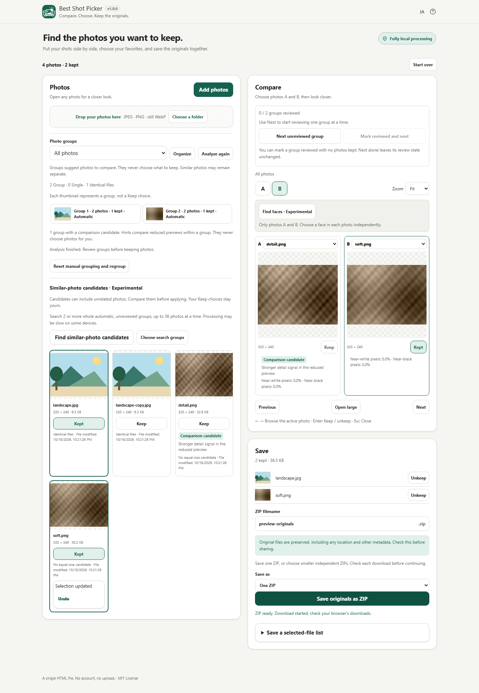

# Best Shot Picker

Compare photos, choose your favorites, and save their untouched originals together in a ZIP.

[日本語](README.ja.md) · [Open the app](https://ttomohisa.github.io/htmlapps-best-shot-picker/)



## Features

- Add JPEG, PNG, and still WebP files, including more photos during a session
- Find identical originals and conservative default similarity groups; split, merge, move, and undo group edits
- Optionally find additional similar-photo candidates with an embedded local model, then review and apply each grouping yourself
- Distinguish JPEG EXIF capture/digitized timestamps from file-modified time
- See group-relative technical comparison candidates and measured reasons; uncertain or tied cases have no recommendation
- Browse thumbnails, open a large view, and compare two photos
- Review groups directly in Compare, skip to the next unfinished group, or mark a group reviewed and continue with Undo
- Optionally find faces in the comparison pair, choose a face to zoom, and return to the whole image
- Switch A / B on phones; inspect 100%, 200%, or 400% views by scrolling
- Keep any number of photos, with Undo for the latest selection change
- Save original file bytes in a ZIP with an editable filename and collision-safe entry names
- Optionally prepare independent ZIP batches, then download and confirm each one before continuing
- Isolate unreadable files, cancel work, and retry unfinished photos
- Japanese / English, keyboard controls, and narrow-screen page tabs

## How to use

1. Choose **Add photos**, drag files into the drop area, or choose a folder when supported. You can add more photos without clearing existing Keep choices or manual groups.
2. Review **Photo groups** or **All photos**. Use **Organize** to split, move, merge, or mark a group reviewed. Open a photo for a closer look. In **Compare**, choose photos A and B. Technical hints may highlight a comparison candidate, but never select it. **Keep** the ones you want.
   In Compare, **Next unreviewed group** only navigates. **Mark reviewed and next** finishes the current group, even with zero Keep choices; Undo returns to it. The last group stays visible when all are reviewed. Import and analysis temporarily pause these controls.
3. Optionally choose **Find similar-photo candidates**. It searches up to 36 eligible photos across at least two automatic, unreviewed groups whose normal analysis is complete. For larger sessions, choose whole groups to compare, totaling at most 36 photos per search. Open the candidate thumbnails to compare, then choose **Apply this grouping** only for a grouping you want. **Undo** reverses the latest group edit. Manual and reviewed groups are excluded.
4. In **Compare**, optionally choose **Find faces**. Select a face separately in each photo to zoom, or return to **Whole image**. Missed or incorrect candidates can occur; manual zoom remains available.
5. In **Save**, review your choices and filename, then choose **Save originals as ZIP** for the usual single archive. For smaller archives, choose the optional ZIP-batch mode and explicitly select 32, 64, 128, 256, or 512 MiB. No capacity is preselected because none has been validated as a safe physical-device default.
6. In batch mode, review the archive sizes and part count before starting. The plan freezes the selected originals, entry names, and output name at that point. Later Keep changes, Undo, group edits, or added photos affect your live collection and the next export, not this plan.
7. Build only the current part, then explicitly download it. Check the browser's download status, then choose **Saved; next ZIP** (or **Saved; finish** for the last one) to acknowledge that it is saved. Prepare the next part separately. Nothing downloads or advances automatically. Each `.zip` opens independently; the files are not pieces of one spanning ZIP.

A cancelled or failed batch build can retry only its current part. Downloading that part again is an explicit action with a duplicate-copy warning. Closing or discarding a prepared/download-requested part asks for confirmation: releasing its download URL can affect an unfinished download. Starting over clears the export plan along with the session after the normal confirmation. Reloading or closing the page loses the plan, so finish saving first.

Arrow keys browse the active comparison photo outside an enlarged image. Tab into an overflowing image to pan with arrow keys instead. Enter toggles Keep when focus is on the page; focused buttons keep their usual action. Esc closes a dialog. Input fields and selectors do not trigger browsing shortcuts.

## Privacy

Processing stays inside the browser. Optional similarity search and face detection use models embedded in the HTML and start only when you choose them. There are no image uploads, runtime APIs, external fonts, analytics, or remote model downloads. Hosted use downloads the initial HTML. Content Security Policy blocks runtime connections with `connect-src 'none'`.

ZIP entries use the original bytes: EXIF, GPS location, color profiles, and other metadata remain. Check metadata before sharing. Original files on your device are never overwritten, moved, or deleted.

Photos and choices are temporary. Reloading, closing the page, or starting over clears the session. Only language preference may be stored.

## Browsers and devices

Designed for modern Chrome and Edge on desktop and phones. Japanese / English layouts target widths of 320px and above. Folder selection appears only when the browser supports it.

Both optional model features, **Find similar-photo candidates** and **Find faces**, require Web Workers and `DecompressionStream`. When either API is absent, the app explains why those features are unavailable. In the readable HTML, manual comparison, Keep, and original-byte ZIP export remain available. Having these APIs does not guarantee that a model can start or finish on every device.

See [validation results](docs/VALIDATION.md) for the environments and checks covered. Physical Android/iPhone 100/500-photo tests, PC 1,000-photo tests, peak memory, and real-photo throughput remain unverified.

## Optional selected-file list

In Save, open **Save a selected-file list** and choose JSON or CSV. The list downloads separately and is never added to a ZIP. It contains only kept files: original name, assigned ZIP entry/archive name, part number, order and byte size. Names may contain personal information. No EXIF/GPS, folder metadata, timestamps or model results are added.

Single-ZIP mode records current Keep at the list click. During smaller-ZIP saving, it uses that plan's starting selection even if Keep changes. It records planned files, not proof of completed downloads. JSON retains exact names; CSV uses `file: ` display prefixes and visible control-character escapes for spreadsheet viewing. This does not restore a selection session. See [the field and CSV contract](docs/SELECTION_LIST.md).

## Limitations

This is the v0.7.1 development version. Sequential ZIP batches are the first bounded portion of the planned v0.8 storage work; the full v0.8 milestone is not complete. Default grouping remains non-ML; the optional local-model search is experimental. Both can miss related photos or suggest unrelated ones. Review every proposed grouping before applying it. Neither selects photos for you, and general photo-grouping accuracy is not guaranteed.

The 36-photo limit applies to each optional search, not the whole session. Choose the groups you want to compare; unselected groups stay unchanged. A group containing more than 36 photos cannot be selected for this search. No photos are silently truncated and existing groups are never split. Adding photos, editing groups, or starting a new analysis clears pending candidates. Applying one proposal clears the others, so search again for current candidates. Cancel or failure leaves existing groups, Keep choices, and originals unchanged. Processing may be slow on some devices; normal comparison and saving remain available.

Technical hints use reduced-preview measurements, not aesthetic or subject judgment. Their agreement with human preferences has not been measured. Noise, intentional blur, line art, and lighting can mislead them; a dark photo is not automatically worse. Face detection is an optional navigation aid for the comparison pair, with up to six candidates per photo. Small, turned or occluded faces may be missed, and candidates can be incorrect. Processing can be slow on some devices. Eye-state estimation, face-based ranking and person matching are not included. HEIC, RAW, TIFF, animated images, and videos are unsupported.

Duplicate hashing is limited to 64 MiB per original and requires Web Crypto. A skipped or unavailable duplicate check does not prevent manual selection or export. Manual groups are preserved on additional imports; Reset manual grouping explicitly rebuilds them.

Images above 100 megapixels or 32,768 pixels on either side are skipped before decoding when the header supplies dimensions, and checked again after decoding. This does not guarantee protection against every malformed image or low-memory device.

The ZIP writer reads bounded chunks for CRC and stores original Blob parts, but each finished archive still uses browser-managed memory. Batch preflight includes the exact ZIP headers, UTF-8 names, and directory overhead, and assigns safe names that remain unique across the whole plan. A file that cannot fit by itself with ZIP overhead stops the plan before any export read; the message names the file and suggests a higher capacity, a different selection, or the single-ZIP mode. Originals are never cut into pieces.

The chosen capacity bounds one archive, not total browser memory, garbage-collection timing, or smartphone safety. Only the current batch archive and its download URL are retained by the batch workflow; original files, previews, and browser-managed download buffers may still consume memory. Each archive must stay within ZIP32 limits (under 65,535 entries and 4 GiB including ZIP overhead). Disk streaming, ZIP64 and spanning ZIP files are not included; optional CSV/JSON lists are separate metadata downloads. Download initiation and your saved confirmation are not an application-verified disk-write result.

## Single HTML / offline use

Save and open the readable `best-shot-picker.html` or `dist/index.html` directly. All application code, icons, model weights, worker code, and license notices are embedded in both forms. Optional similarity and face-model assets are decompressed only when needed; both features share the browser requirements above.

`dist/index.self-extract.html` is a gzip-wrapped alternative that restores the same app. It cannot open without `DecompressionStream`; use the readable HTML instead. Once the readable app is open, missing model capabilities do not prevent manual comparison, Keep, or original-byte ZIP export.

## Development

Read `AGENTS.md`, `APP_SPEC.md`, `DEVELOPMENT_PLAN.md`, and `ACCEPTANCE_MATRIX.md`. Edit `src/index.template.html`, `src/app.js`, `src/core.js`, `src/grouping.js`, `src/quality.js`, `src/similarity.js`, `src/embedding-worker-client.js`, `src/embedding-worker.js`, `src/face-geometry.js`, `src/face-worker-client.js`, and `src/face-worker.js`; do not edit generated HTML. Pinned model assets and their hash manifests are in `assets/embedding/` and `assets/face-detection/`.

On Windows, run `build-standalone.bat`. The canonical PowerShell builder generates both variants and the exact root HTML copy. Run PowerShell syntax preflight and `scripts/check-repository.ps1` before completion.

Test tooling requires Node.js 22 or later:

```sh
npm ci
npm test
npm run test:grouping
npx playwright install chromium
npm run test:browser
```

Browser tests use synthetic, non-personal images and open both generated HTML files with `file://`. Test fixtures are project-owned; regenerate them with `python tests/fixtures/generate.py` or `python tests/fixtures/generate-quality.py` and Pillow. No Node/npm tooling is required to use or build the standard Windows app.

## License

The app is MIT-licensed. The optional model features share TensorFlow.js 4.22.0 and bundle Google MobileNet V1 0.25 224 feature vector v2, @tensorflow-models/face-detection 1.0.3, and MediaPipe face-detection short TFJS v1 under Apache-2.0, with preserved third-party notices. The help dialog includes the embedded software and model notices. See [LICENSE](LICENSE) and [THIRD_PARTY_NOTICES.md](THIRD_PARTY_NOTICES.md).

See [grouping design and evaluation limits](docs/GROUPING.md).

See [technical-hint design and evidence limits](docs/QUALITY.md) and the [isolated embedding feasibility experiment](experiments/embedding/README.md).

The frozen-protocol HDR+ holdout is research evidence for this bounded, optional feature, not an accuracy guarantee. Research photographs and evaluation tools are excluded from the distributed app; see [experiment scope and limits](experiments/embedding/README.md#independent-hdr-burst-holdout).
